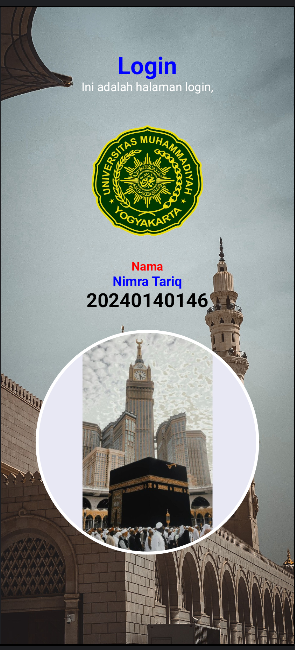
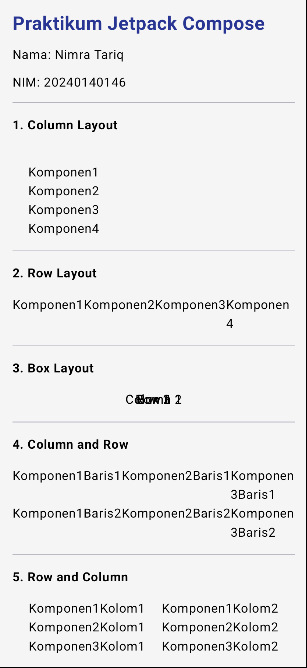
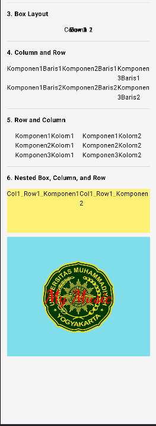

# ActBasicComposable_0146

Praktikum Pertemuan 3 - Jetpack Compose layouts and a login page.

## Files
- TataLetak.kt: the six layouts from the module (column, row, box and the nested ones)
- Tugas.kt: a page that shows all six layouts with my name and NIM
- TugasLogin.kt: the login page

## Login page

Background photo, UMY logo, my name and NIM, and a round photo.

## Photos
The background and the round photo are free-to-use photos from the internet. The logo is the UMY emblem.

## Tugas page

All six layouts from the module, with my name and NIM at the top. The page is long, so it's split into two screenshots.